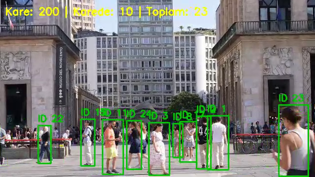

<div align="center">

# 👥 YOLOv8 Person Counting

### Video-Based Person Detection and Counting Application

YOLOv8 Person Counting detects people in uploaded videos, analyzes each processed frame, and presents the results through a simple Gradio interface.

<br>


</div>

---

## 📖 About

YOLOv8 Person Counting is a computer vision project developed to demonstrate person detection and video analysis.

The application accepts an uploaded video, processes its frames using a pretrained YOLOv8 model, and generates an annotated output video. Detection is restricted to the `person` class, and ByteTrack follows each person across frames so that every individual is counted once.

> This project was developed for educational and internship purposes. It is not intended for surveillance, biometric identification, or real-world demographic analysis.

---

## 📌 Contents

- [Key Features](#-key-features)
- [How It Works](#️-how-it-works)
- [Technologies](#️-technologies)
- [Project Structure](#-project-structure)
- [Installation](#-installation)
- [Usage](#-usage)
- [Output](#-output)
- [Important Limitations](#️-important-limitations)
- [Future Improvements](#-future-improvements)
- [Author](#-author)

---

## ✨ Key Features

- Detects people in uploaded videos
- Uses a pretrained YOLOv8 model
- Restricts detection to the `person` class
- Tracks people across frames with ByteTrack
- Counts unique individuals across the whole video
- Draws bounding boxes and track IDs around detected people
- Displays the current and total person counts on each processed frame
- Produces an annotated MP4 output video
- Presents results through a Gradio interface
- Creates a summary table using Pandas
- Uses frame sampling to improve processing performance

---

## ⚙️ How It Works

1. The user uploads an MP4 video through the Gradio interface.
2. OpenCV reads and processes the video frames.
3. YOLOv8 detects people in each processed frame.
4. ByteTrack assigns each person a track ID that stays the same across frames.
5. Bounding boxes and track IDs are drawn around detected people.
6. The processed frames are written to a new video file.
7. The annotated video and a summary table are returned to the user.

---

## 🛠️ Technologies

| Technology | Purpose |
|---|---|
| Python | Core application language |
| YOLOv8 | Person detection |
| ByteTrack | Multi-object tracking |
| OpenCV | Video processing and annotation |
| Gradio | Web-based user interface |
| PyTorch | Deep-learning runtime |
| NumPy | Numerical operations |
| Pandas | Summary table creation |

---

## 📁 Project Structure

```text
yolov8-person-counting/
├── images/
├── app.py
├── requirements.txt
└── README.md
```

The `outputs/` directory is created automatically when the application processes a video.

---

## 🚀 Installation

### 1. Clone the Repository

```bash
git clone https://github.com/betulaltunyuva/yolov8-person-counting.git
cd yolov8-person-counting
```

### 2. Create a Virtual Environment

```bash
python -m venv venv
```

### 3. Activate the Virtual Environment

#### Windows PowerShell

```powershell
.\venv\Scripts\Activate.ps1
```

#### Windows Command Prompt

```cmd
venv\Scripts\activate
```

#### Linux or macOS

```bash
source venv/bin/activate
```

### 4. Install the Dependencies

```bash
pip install -r requirements.txt
```

---

## ▶️ Usage

Start the application with:

```bash
python app.py
```

Open the local Gradio address displayed in the terminal. Upload an MP4 video and wait for the analysis to finish.

The pretrained `yolov8n.pt` model may be downloaded automatically during the first run.

---

## 📊 Output



The application returns:

- An annotated output video
- A summary table generated with Pandas, containing:
  - the number of unique people in the video
  - the highest number of people seen in a single frame

Generated videos are saved inside the automatically created `outputs/` directory.

---

## ⚠️ Important Limitations

Unique counts depend on the tracker keeping the same ID for each person. Results may be affected by:

- Occlusion (people hiding behind each other or objects)
- People leaving and re-entering the frame, which can give them a new ID
- Lighting conditions
- Video quality
- Camera angle
- Partially visible people
- Object-detection errors

---

## 🔮 Future Improvements

- Add configurable confidence thresholds
- Improve video processing speed
- Support additional video formats
- Add performance evaluation metrics
- Add automated tests
- Add GPU configuration guidance

---

## 👩‍💻 Author

**Betül Altunyuva**

Software Engineering Student

[GitHub Profile](https://github.com/betulaltunyuva)

---

<div align="center">

Developed for computer vision learning and experimentation.

⭐ If you find the project useful, consider giving it a star.

</div>


