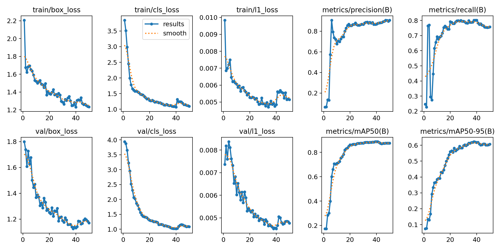
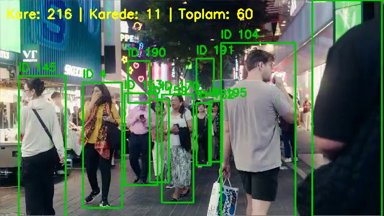

<div align="center">

# 👥 Smart Human Counting

### Video-Based Person Counting with a Custom-Trained YOLO Model

A person detector **trained on my own hand-labeled dataset**, combined with ByteTrack to count every individual in a video exactly once.

<br>


</div>

---

## 📖 About

This project counts people in videos with a detector that I trained myself instead of using an off-the-shelf model.

I built the dataset from scratch: frames were sampled from two crowd videos, **160 images were labeled by hand in Roboflow** with **6,306 `person` bounding boxes**, and a COCO-pretrained **YOLO26n** model was fine-tuned on them. The trained weights (`models/best.pt`) power a Gradio application that detects people frame by frame, follows them with **ByteTrack**, and reports how many different people appeared in the video.

> This project was developed for educational and internship purposes. It is not intended for surveillance, biometric identification, or real-world demographic analysis.

---

## 📌 Contents

- [Key Features](#-key-features)
- [Pipeline](#️-pipeline)
- [Dataset](#-dataset)
- [Training](#-training)
- [Results](#-results)
- [Technologies](#️-technologies)
- [Project Structure](#-project-structure)
- [Installation](#-installation)
- [Usage](#-usage)
- [Important Limitations](#️-important-limitations)
- [Future Improvements](#-future-improvements)
- [Developer](#-developer)

---

## ✨ Key Features

- **Custom dataset:** 160 hand-labeled frames, 6,306 person annotations
- **Fine-tuned detector:** YOLO26n trained for 50 epochs on the custom data
- **mAP50 of 0.884** on the validation split
- Tracks people across frames with ByteTrack and counts each one once
- Draws bounding boxes and track IDs on every processed frame
- Shows the current and total person counts on the video
- Produces an annotated MP4 output and a summary table
- Simple web interface built with Gradio
- Frame sampling and resizing for faster processing

---

## ⚙️ Pipeline

```text
 Training videos ──► extract_frames.py ──► 160 frames ──► Roboflow labeling
                                                               │
                                                               ▼
 Gradio app ◄── models/best.pt ◄── train.py (YOLO26n, 50 epochs) ◄── dataset/
     │
     ▼
 Upload video ──► detect (best.pt) ──► track (ByteTrack) ──► count unique IDs ──► annotated video + table
```

1. **Frame extraction:** `training/extract_frames.py` samples 80 evenly spaced frames from each training video.
2. **Annotation:** Every person in every frame is labeled with a bounding box in Roboflow.
3. **Training:** `training/train.py` fine-tunes YOLO26n on the exported dataset.
4. **Inference:** `app.py` loads `models/best.pt`, detects people in each processed frame, and ByteTrack assigns each person an ID that stays the same across frames.
5. **Counting:** The number of distinct track IDs is the number of unique people in the video.

---

## 🗂️ Dataset

| | Value |
|---|---|
| **Source** | 2 crowd videos (80 frames sampled from each) |
| **Images** | 160 |
| **Annotations** | 6,306 bounding boxes |
| **Classes** | 1 (`person`) |
| **People per image** | 8 to 76 (≈ 39 on average) |
| **Labeling tool** | [Roboflow](https://universe.roboflow.com/betul-zibcu/smart-human-counting-v2/dataset/1) |
| **Format** | YOLO (`class x_center y_center width height`) |
| **Pre-processing** | Auto-orientation, resize to 640 × 640 (fit within) |
| **Augmentation** | None at export time (YOLO's built-in training augmentations only) |
| **License** | CC BY 4.0 |

| Split | Images | Boxes |
|---|---|---|
| Train | 112 (70%) | 4,332 |
| Validation | 32 (20%) | 1,219 |
| Test | 16 (10%) | 755 |

The full dataset is included in the `dataset/` folder, ready to train with `dataset/data.yaml`.

---

## 🏋️ Training

The model was fine-tuned on a Google Colab GPU with transfer learning from the COCO-pretrained YOLO26 nano checkpoint.

| Hyperparameter | Value |
|---|---|
| Base model | `yolo26n.pt` (COCO-pretrained) |
| Epochs | 50 |
| Batch size | 16 |
| Image size | 640 |
| Optimizer | `auto` (Ultralytics default) |
| Hardware | Google Colab GPU |
| Training time | ≈ 2.5 minutes |
| Framework | Ultralytics 8.4.163 |

To retrain the model:

```bash
python training/train.py
```

---

## 📊 Results

Validation metrics of the best checkpoint (epoch 38), which is saved as `models/best.pt`:

| Metric | Epoch 1 | **Best (epoch 38)** |
|---|---|---|
| Precision | 0.063 | **0.866** |
| Recall | 0.247 | **0.802** |
| mAP50 | 0.174 | **0.884** |
| mAP50-95 | 0.074 | **0.622** |

<p align="center">
  
  <br><sub>Loss and metric curves over 50 epochs</sub>
</p>

The full per-epoch log is available in `results/results.csv`.

### Application output

<p align="center">
  
  <br><sub>Output of the custom model on a test video that was not used for training</sub>
</p>

For every uploaded video, the application returns:

- An annotated output video with bounding boxes and track IDs
- A summary table with:
  - the number of unique people in the video
  - the highest number of people seen in a single frame

---

## 🛠️ Technologies

| Technology | Purpose |
|---|---|
| Python | Core language |
| Roboflow | Dataset annotation and export |
| Ultralytics YOLO26 | Model training and person detection |
| ByteTrack | Multi-object tracking |
| OpenCV | Frame extraction, video processing and annotation |
| PyTorch | Deep-learning runtime |
| Gradio | Web-based user interface |
| Pandas | Summary table creation |

---

## 📁 Project Structure

```text
yolov8-person-counting/
├── app.py                   # Gradio application (detection + tracking + counting)
├── models/
│   └── best.pt              # Custom-trained YOLO26n weights
├── dataset/
│   ├── data.yaml            # Dataset configuration
│   ├── train/               # 112 images + labels
│   ├── valid/               # 32 images + labels
│   └── test/                # 16 images + labels
├── training/
│   ├── extract_frames.py    # Samples frames from the training videos
│   └── train.py             # Fine-tunes YOLO26n on the dataset
├── results/
│   └── results.csv          # Per-epoch training log
├── images/                  # Figures used in this README
├── requirements.txt
└── README.md
```

The `outputs/` directory is created automatically when the application processes a video. The raw training videos are not included because of their size.

---

## 🚀 Installation

### 1. Clone the Repository

```bash
git clone https://github.com/betulaltunyuva/yolov8-person-counting.git
cd yolov8-person-counting
```

### 2. Create a Virtual Environment

```bash
python -m venv venv
```

### 3. Activate the Virtual Environment

#### Windows PowerShell

```powershell
.\venv\Scripts\Activate.ps1
```

#### Windows Command Prompt

```cmd
venv\Scripts\activate
```

#### Linux or macOS

```bash
source venv/bin/activate
```

### 4. Install the Dependencies

```bash
pip install -r requirements.txt
```

---

## ▶️ Usage

Start the application with:

```bash
python app.py
```

Open the local Gradio address displayed in the terminal (`http://127.0.0.1:7861`). Upload an MP4 video and wait for the analysis to finish.

The custom model is loaded from `models/best.pt`; no extra download is needed.

---

## ⚠️ Important Limitations

- **Small dataset:** 160 images from only two videos. The model may not generalize to very different scenes, camera angles or lighting.
- **Optimistic metrics:** Train, validation and test frames come from the same two videos, so neighboring frames can look very similar across splits. Scores on completely new videos are likely to be lower.
- **Tracking errors:** Unique counts depend on the tracker keeping the same ID for each person. Occlusion, people leaving and re-entering the frame, or missed detections can create extra IDs.
- **Speed vs. accuracy:** To speed up processing, the video is downscaled (`RESIZE_DIV = 6`) and every second frame is skipped (`FRAME_STEP = 2`), which can make small or distant people harder to detect.

---

## 🔮 Future Improvements

- Add frames from more videos and scenes, and split the data by video instead of by frame
- Report results on the held-out test split and on unseen videos
- Compare the fine-tuned model with the pretrained COCO model on the same videos
- Add configurable confidence and IoU thresholds in the interface
- Add line-crossing (in / out) counting
- Add automated tests

---

## 💻 Developer

<table>
<tr>
<td>

**Betül Altunyuva**
Software Engineering Student
GitHub: [@betulaltunyuva](https://github.com/betulaltunyuva)

</td>
</tr>
</table>

<div align="center">

⭐ If you found this project useful, consider giving it a star!

</div>
