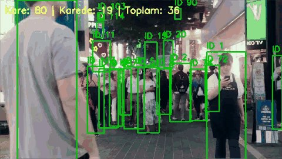
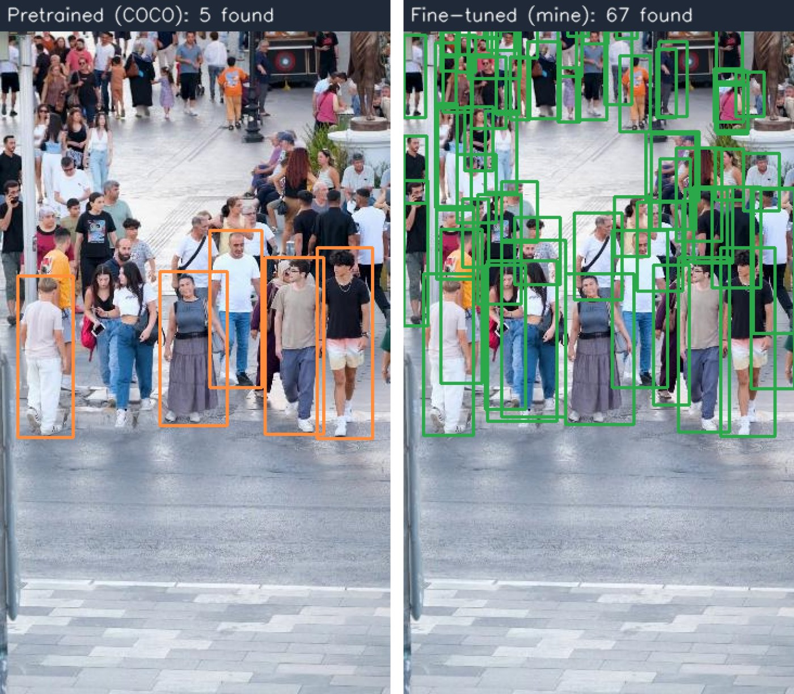
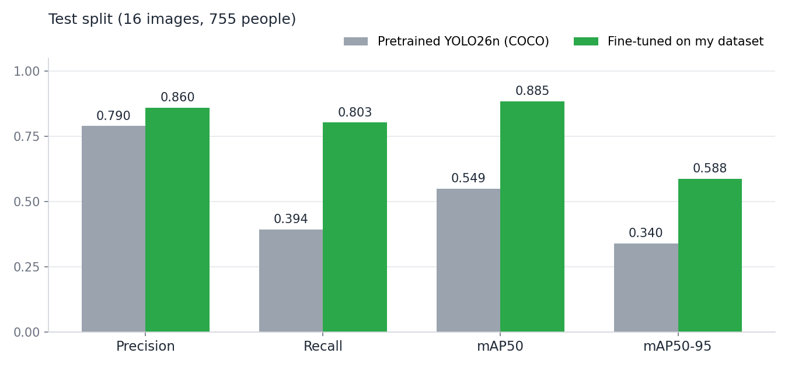
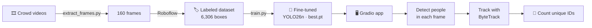
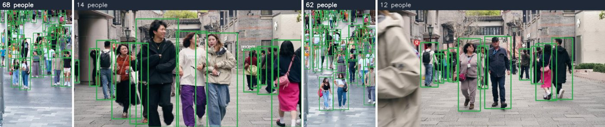
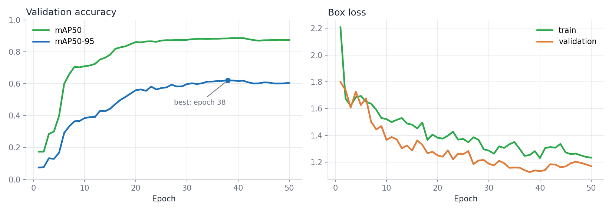

<div align="center">

# 👥 Smart Human Counting

**Counting people in crowded videos with a YOLO model I trained on my own hand-labeled dataset**


<br>



<sub>The application running on a test video that was never used for training</sub>

</div>

<br>

<table align="center">
<tr>
<td align="center" width="25%"><h2>160</h2>hand-labeled images</td>
<td align="center" width="25%"><h2>6,306</h2>person annotations</td>
<td align="center" width="25%"><h2>0.885</h2>test mAP50</td>
<td align="center" width="25%"><h2>2×</h2>recall vs. pretrained model</td>
</tr>
</table>

---

## 📖 About

Off-the-shelf detectors struggle in **dense crowds**, where people are small, far away and hidden behind each other. Instead of relying on a pretrained model, I built the whole pipeline myself:

1. 🎞️ **Collected** frames from crowd videos
2. 🏷️ **Labeled** every person by hand in Roboflow (6,306 boxes)
3. 🏋️ **Fine-tuned** a YOLO26n detector on this dataset
4. 🔢 **Deployed** it in a Gradio app that tracks people with ByteTrack and counts each person once

> This project was developed for educational and internship purposes. It is not intended for surveillance, biometric identification, or real-world demographic analysis.

---

## 📌 Contents

- [Why Train My Own Model?](#-why-train-my-own-model)
- [Pipeline](#️-pipeline)
- [Dataset](#️-dataset)
- [Training](#️-training)
- [Results](#-results)
- [Quick Start](#-quick-start)
- [Project Structure](#-project-structure)
- [Technologies](#️-technologies)
- [Limitations & Future Work](#️-limitations--future-work)
- [Developer](#-developer)

---

## 🎯 Why Train My Own Model?

The same test image, the same confidence threshold (0.25), two different models:

<p align="center">
  
  <br><sub>This frame contains <b>67</b> labeled people. The pretrained model only finds the 5 largest people in the front.</sub>
</p>

Across the whole test split, fine-tuning **doubled recall** (0.39 → 0.80) and raised **mAP50 from 0.549 to 0.885**:

<p align="center">
  
</p>

---

## ⚙️ Pipeline



| Step | What happens |
|---|---|
| **Frame extraction** | `training/extract_frames.py` samples 80 evenly spaced frames from each training video |
| **Annotation** | Every visible person is labeled with a bounding box in Roboflow |
| **Training** | `training/train.py` fine-tunes the COCO-pretrained YOLO26n on the dataset |
| **Detection** | `app.py` runs `models/best.pt` on every processed frame |
| **Tracking** | ByteTrack gives each person an ID that stays the same across frames |
| **Counting** | The number of distinct IDs is the number of unique people in the video |

---

## 🗂️ Dataset

<p align="center">
  
  <br><sub>Training images with their hand-drawn labels. Scenes range from a dozen people to dense crowds.</sub>
</p>

<table>
<tr>
<td width="55%" valign="top">

| | |
|---|---|
| **Images** | 160 frames from 2 crowd videos |
| **Annotations** | 6,306 bounding boxes |
| **Class** | `person` |
| **People per image** | 8 to 76 (≈ 39 on average) |
| **Labeling tool** | [Roboflow](https://universe.roboflow.com/betul-zibcu/smart-human-counting-v2/dataset/1) |
| **Pre-processing** | Auto-orient, resize to 640 (fit within) |
| **License** | CC BY 4.0 |

</td>
<td width="45%" valign="top">

| Split | Images | Boxes |
|---|---|---|
| 🟩 Train | 112 | 4,332 |
| 🟨 Validation | 32 | 1,219 |
| 🟥 Test | 16 | 755 |
| **Total** | **160** | **6,306** |

The full dataset is included in [`dataset/`](dataset) and is ready to use with `dataset/data.yaml`.

</td>
</tr>
</table>

---

## 🏋️ Training

The model was fine-tuned on a Google Colab GPU, starting from the COCO-pretrained YOLO26 nano checkpoint (transfer learning).

<p align="center">
  
</p>

| Hyperparameter | Value |
|---|---|
| Base model | `yolo26n.pt` (COCO-pretrained) |
| Epochs | 50 (best checkpoint: epoch 38) |
| Batch size | 16 |
| Image size | 640 |
| Optimizer | `auto` (Ultralytics default) |
| Hardware | Google Colab GPU, ≈ 2.5 minutes |
| Framework | Ultralytics 8.4.163 |

Accuracy climbs quickly in the first 20 epochs and levels off after epoch 30. The full per-epoch log is in [`results/results.csv`](results/results.csv).

To retrain the model:

```bash
python training/train.py
```

---

## 📊 Results

| Model | Split | Precision | Recall | mAP50 | mAP50-95 |
|---|---|---|---|---|---|
| Pretrained YOLO26n (COCO) | Test | 0.790 | 0.394 | 0.549 | 0.340 |
| **Fine-tuned (`best.pt`)** | Validation | 0.872 | 0.807 | 0.885 | 0.621 |
| **Fine-tuned (`best.pt`)** | **Test** | **0.860** | **0.803** | **0.885** | **0.588** |

For every uploaded video, the application returns:

- 🎬 an annotated video with bounding boxes, track IDs and live counts
- 📋 a summary table with the **number of unique people** and the **highest number of people in a single frame**

---

## 🚀 Quick Start

```bash
# 1. Clone the repository
git clone https://github.com/betulaltunyuva/yolov8-person-counting.git
cd yolov8-person-counting

# 2. Create and activate a virtual environment
python -m venv venv
venv\Scripts\activate          # Windows
# source venv/bin/activate     # Linux / macOS

# 3. Install the dependencies
pip install -r requirements.txt

# 4. Start the application
python app.py
```

Open `http://127.0.0.1:7861` in your browser, upload an MP4 video and wait for the analysis to finish. The custom model is loaded from `models/best.pt`, so no extra download is needed.

---

## 📁 Project Structure

```text
yolov8-person-counting/
├── app.py                   # Gradio app: detection + tracking + counting
├── models/
│   └── best.pt              # Fine-tuned YOLO26n weights
├── dataset/
│   ├── data.yaml            # Dataset configuration
│   ├── train/               # 112 images + labels
│   ├── valid/               # 32 images + labels
│   └── test/                # 16 images + labels
├── training/
│   ├── extract_frames.py    # Samples frames from the training videos
│   └── train.py             # Fine-tunes YOLO26n on the dataset
├── results/
│   └── results.csv          # Per-epoch training log
├── images/                  # Figures used in this README
└── requirements.txt
```

---

## 🛠️ Technologies

| Technology | Purpose |
|---|---|
| **Roboflow** | Dataset annotation and export |
| **Ultralytics YOLO26** | Model training and person detection |
| **ByteTrack** | Multi-object tracking across frames |
| **OpenCV** | Frame extraction, video processing and drawing |
| **PyTorch** | Deep-learning runtime |
| **Gradio** | Web interface |
| **Pandas** | Summary table |

---

## ⚠️ Limitations & Future Work

**Limitations**

- **Small dataset:** 160 images from only two videos, so the model may not generalize to very different scenes, camera angles or lighting.
- **Optimistic scores:** Train, validation and test frames come from the same two videos. Part of the gain over the pretrained model comes from adapting to these specific scenes, and scores on completely new videos are likely to be lower.
- **Over-counting:** Unique counts depend on the tracker keeping the same ID for each person. Occlusion, people leaving and re-entering the frame, or missed detections can create extra IDs.
- **Speed vs. accuracy:** To run faster, the app downscales the video (`RESIZE_DIV = 6`) and skips every second frame (`FRAME_STEP = 2`), which makes small or distant people harder to detect.

**Future work**

- [ ] Add frames from more videos and scenes, and split the data by video instead of by frame
- [ ] Evaluate on completely unseen videos with ground-truth counts
- [ ] Reduce ID switches by tuning the tracker
- [ ] Add line-crossing (in / out) counting
- [ ] Make confidence and IoU thresholds adjustable in the interface

---

## 💻 Developer

<table>
<tr>
<td>

**Betül Altunyuva**
Software Engineering Student
GitHub: [@betulaltunyuva](https://github.com/betulaltunyuva)

</td>
</tr>
</table>

<div align="center">

⭐ If you found this project useful, consider giving it a star!

</div>
